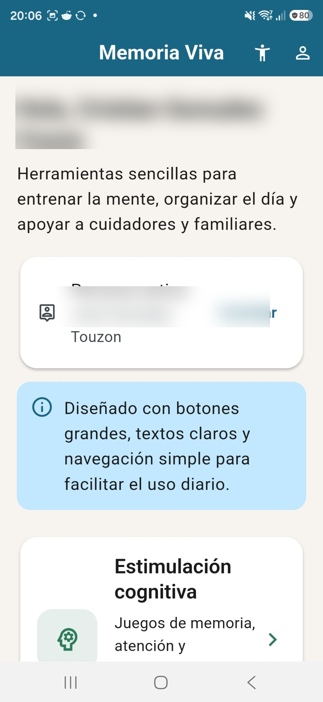
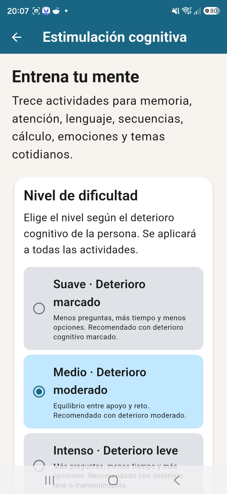
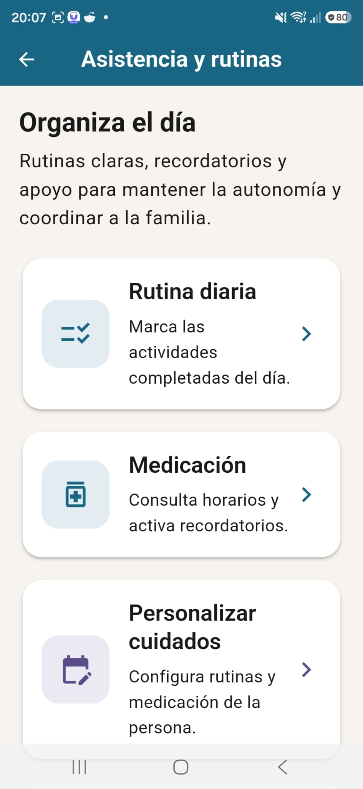
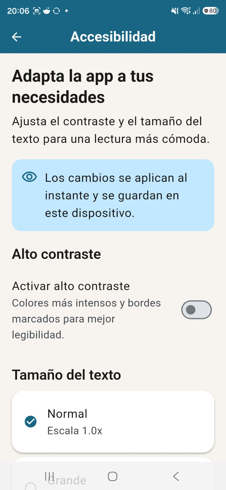
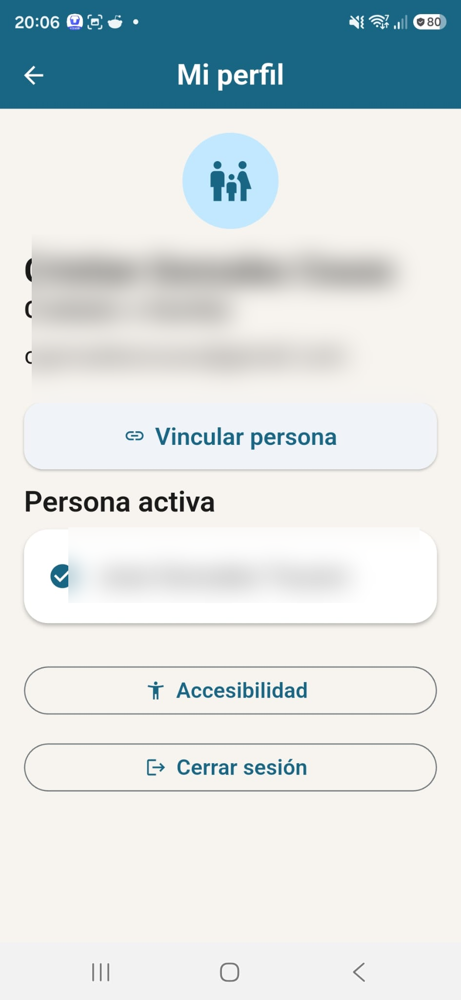
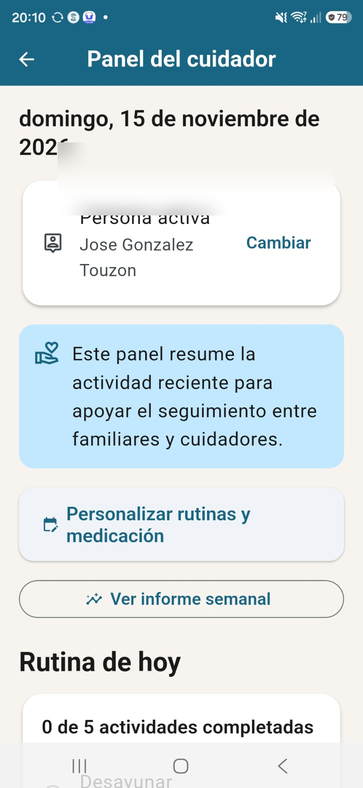
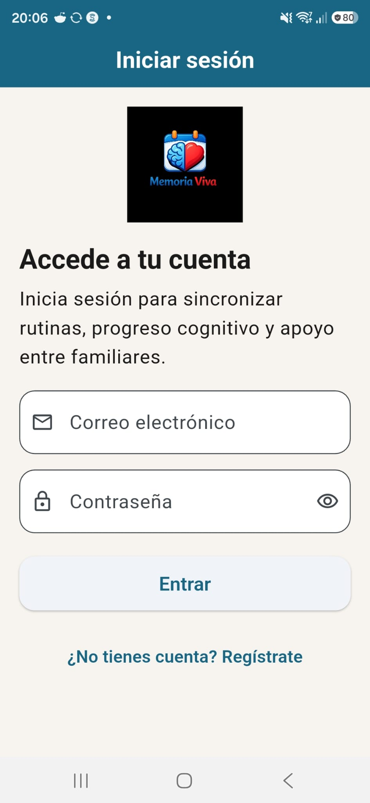

# 🧠 Memoria Viva

**Aplicación multiplataforma de apoyo cognitivo, organización de rutinas y acompañamiento familiar.**

  

> **Proyecto personal en desarrollo.** Las imágenes muestran pantallas reales de la aplicación. Las funcionalidades descritas como previstas forman parte de la visión del proyecto y no deben interpretarse como funcionalidades ya verificadas en producción.

## El proyecto

Memoria Viva nace con el objetivo de ofrecer una experiencia digital sencilla y accesible para personas con deterioro cognitivo y su entorno de apoyo. La propuesta combina **estimulación cognitiva**, **asistencia en tareas cotidianas** y **herramientas para familiares y cuidadores**.

El diseño prioriza la lectura clara, los controles de tamaño generoso, la organización por tareas y la personalización de la accesibilidad.

## 📱 Capturas de la aplicación

*Capturas reales de Android. Los datos personales visibles en algunas pantallas se han ocultado para su publicación.*

<table>
<tr>
<td align="center"> <b>Inicio</b></td>
<td align="center"> <b>Estimulación cognitiva</b></td>
<td align="center"> <b>Asistencia y rutinas</b></td>
</tr>
<tr>
<td align="center"> <b>Accesibilidad</b></td>
<td align="center"> <b>Perfil de cuidador</b></td>
<td align="center"> <b>Panel del cuidador</b></td>
</tr>
<tr><td align="center"> <b>Inicio de sesión</b></td></tr>
</table>

## ✨ Áreas funcionales

### 🧩 Estimulación cognitiva
- Pantalla de acceso a actividades de entrenamiento cognitivo.
- Selección visible de **tres niveles de dificultad**: suave, medio e intenso.
- La interfaz presenta actividades orientadas a memoria, atención, lenguaje y otras capacidades.
- **En desarrollo / por verificar:** ejecución completa de cada ejercicio, métricas de rendimiento y seguimiento longitudinal.

### 📅 Asistencia y rutinas
- Pantallas de navegación para **rutina diaria**, **medicación** y **personalización de cuidados**.
- Interfaz orientada a organizar tareas y facilitar su consulta.
- **En desarrollo / por verificar:** persistencia de recordatorios, programación de avisos y notificaciones automáticas.

### 👥 Personas cuidadoras
- Pantallas de perfil, asociación de una persona activa y panel de cuidador.
- Accesos visibles a personalización de rutinas y medicación, informe semanal y resumen de actividades.
- **En desarrollo / por verificar:** sincronización remota completa, informes con datos reales y permisos de acceso entre cuentas.

### ♿ Accesibilidad
- Pantalla de preferencias con opciones de **alto contraste** y **tamaño de texto**.
- Diseño con navegación clara, textos grandes y botones de fácil identificación.
- La presencia de controles en las capturas no constituye por sí sola una auditoría de accesibilidad.

## 🛠️ Tecnologías

| Tecnología | Uso previsto / documentado |
| --- | --- |
| **Flutter** | Interfaz y desarrollo multiplataforma |
| **Dart** | Lógica de la aplicación |
| **Supabase** | Servicios de backend y autenticación |
| **PostgreSQL** | Base de datos relacional a través de Supabase |
| **Supabase Realtime** | Sincronización de eventos, contemplada en la arquitectura del proyecto |

> La pila tecnológica está documentada en la descripción del proyecto. Este repositorio puede no contener todavía el código necesario para comprobar cada integración.

## 🧭 Retos de diseño y desarrollo

- **Accesibilidad desde la interfaz:** presentar información relevante de forma comprensible y sin sobrecarga visual.
- **Diferentes perfiles de uso:** adaptar la navegación a la persona usuaria y a quien proporciona cuidados.
- **Organización del día a día:** estructurar rutinas y recordatorios con una interacción sencilla.
- **Evolución del producto:** diseñar una base que pueda incorporar seguimiento y sincronización sin complicar la experiencia.

## 🚧 Estado y próximos pasos

**En desarrollo.** La galería documenta el estado visual de distintas pantallas; no implica que todos los flujos estén terminados. La hoja de ruta prevista incluye validar los ejercicios de principio a fin, completar la gestión de rutinas y recordatorios, verificar la sincronización entre perfiles y realizar pruebas de usabilidad y accesibilidad.

## 🔗 Enlaces

- **Caso de estudio y portfolio:** [Cristian González Couso](https://cristian-gonzalez-portfolio.vercel.app/)
- **Repositorio:** [cgonzalezcouso/memoria_viva](https://github.com/cgonzalezcouso/memoria_viva)
- **Autor:** [Cristian González Couso](https://github.com/cgonzalezcouso)

---

*Memoria Viva es un proyecto tecnológico de apoyo y organización; no sustituye la valoración ni el seguimiento de profesionales sanitarios.*
